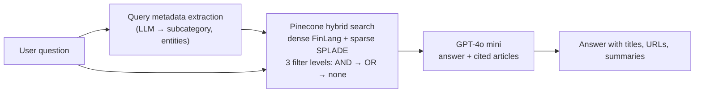

# News Q&A with Hybrid RAG

A retrieval-augmented generation (RAG) system that answers questions about current affairs and business news and cites the articles it used. Built on the [Microsoft News Dataset (MIND)](https://msnews.github.io/), scoped to the `news` and `finance` categories (~18.9k articles).

> Built in 3 days (April 2025) as a technical assessment · refactored October 2026

## How it works



- **Hybrid retrieval.** Each article is indexed in Pinecone with a dense vector from [FinLang/finance-embeddings-investopedia](https://huggingface.co/FinLang/finance-embeddings-investopedia) (768-d) and a [SPLADE](https://github.com/naver/splade) sparse vector. Queries combine the two as `alpha · dense + (1 − alpha) · sparse`, with `alpha = 0.5` by default.
- **LLM metadata filters with fallback.** An LLM extracts the subcategory and named entities from the question. Pinecone has no "should"/boosting clauses, so retrieval runs in three passes with progressively looser filters (subcategory AND entities → subcategory OR entities → no filter), skipping documents already retrieved.
- **Structured generation.** GPT-4o mini returns a conversational answer plus a list of source articles (title, URL, summary), validated with Pydantic.
- **Evaluation.** A click-based precision/recall attempt on MIND impression logs, and an LLM judge that scores relevance and groundedness.

The query-extraction LLM was Llama 3.2 3B via Ollama in the original version. The refactor makes OpenAI (GPT-4o mini) the default and keeps Ollama as an optional local backend.

## Results

_In progress._ A known-item retrieval benchmark (Hit@k, MRR for dense / sparse / hybrid / hybrid + filters, and an `alpha` sweep), an LLM-judge study with hand checks, a citation check, and per-stage latency and cost per query are being added. Every number will be generated by a script into `results/`.

## Repository layout

```
notebooks/news_hybrid_rag.ipynb   walkthrough: EDA, indexing, retrieval, generation, evaluation
requirements.txt                  Python 3.11 dependencies
```

## How to run

1. Download **MIND-small** (training set) from the [MIND site](https://msnews.github.io/) and unzip it to `data/train/` (`news.tsv`, `behaviors.tsv`). The data is not redistributed here.
2. Install dependencies (Python 3.11):
   ```bash
   pip install -r requirements.txt
   ```
3. Set API keys as environment variables:
   ```bash
   export OPENAI_API_KEY=...
   export PINECONE_API=...
   ```
4. For the original local query extraction, install [Ollama](https://ollama.com/) and run `ollama pull llama3.2`.
5. Open `notebooks/news_hybrid_rag.ipynb`. Embedding ~18.9k articles is slow on CPU; a GPU (e.g. Colab) is recommended for building the index.

## Limitations and known issues

- **Entity filter key typo.** The retrieval filters use the metadata key `entitites` while the index stores `entities`, so entity filtering never matches. In practice the strict pass returns nothing and the OR pass filters on subcategory only. To be fixed and measured in the refactor.
- **Click-based evaluation didn't work.** Generating a likely query from a user's browsing history and scoring against their clicks gave near-zero precision/recall@100 on 50 impressions: impressions aren't query-driven, and inferred queries don't capture what the user was looking for. It is kept in the notebook as a negative result.
- **Judge bias.** The LLM judge is GPT-4o mini, the same model as the generator, so scores are likely optimistic (self-preference bias).
- **Scope.** MIND-small only, news and finance categories, articles from autumn 2019. Answers can't cover anything newer.

## Next steps

- Fine-tune a general embedding model on MIND news/finance instead of relying on an Investopedia-tuned model.
- Cross-encoder reranking over hybrid candidates (as a measured ablation).
- Use the MIND knowledge-graph entity embeddings.
- Measure filter accuracy directly against labelled subcategories.

## Data and licence

MIND is provided by Microsoft for research purposes under the [Microsoft Research License Terms](https://github.com/msnews/MIND/blob/master/MSR%20License_Data.pdf). This repository contains no MIND data.

> Wu et al. *MIND: A Large-scale Dataset for News Recommendation.* ACL 2020.
